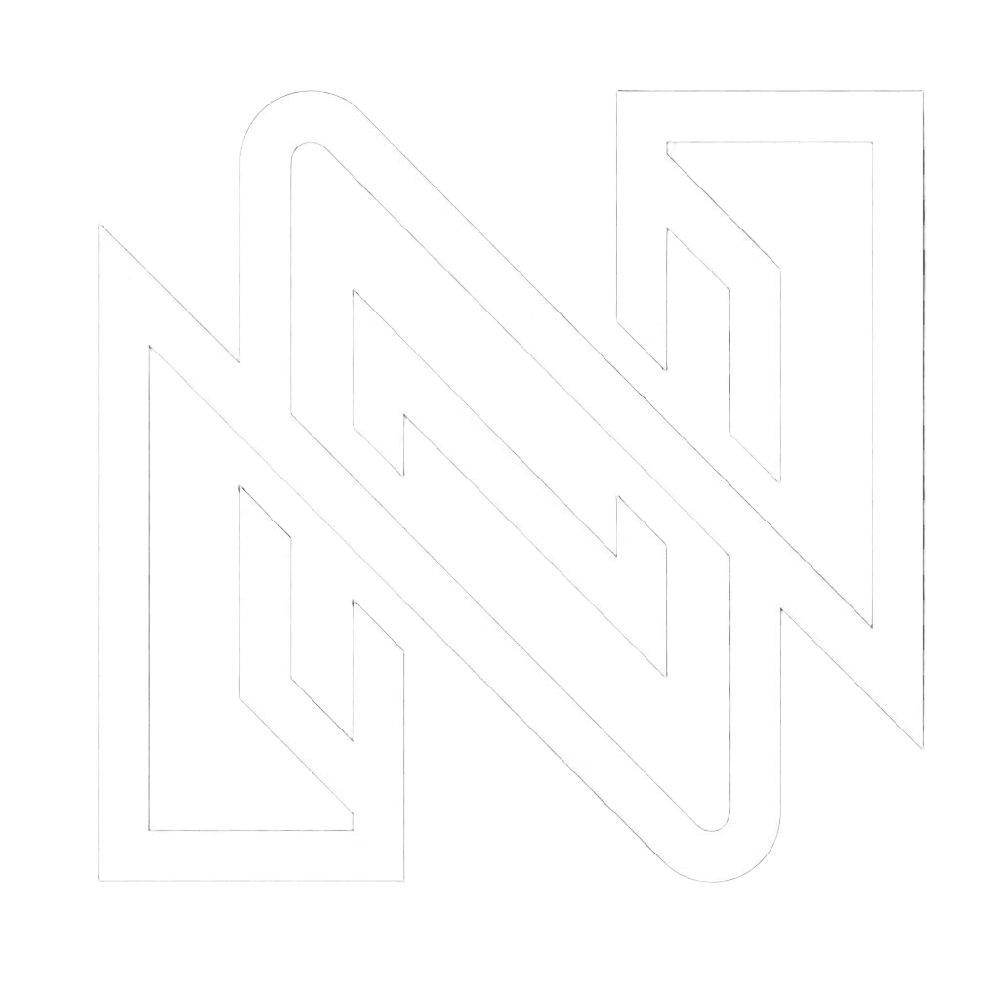

<div align="center">
  
  <h1>PT Nafeka Kreasi Nusantara</h1>
  <p><strong>Ideas into Creations — Teknologi, Kreativitas, dan Inovasi Digital</strong></p>

  <p>
    <a href="https://nafeka.my.id/"></a>
    <a href="https://mainkode.nafeka.my.id/"></a>
    <a href="https://blog.nafeka.my.id/"></a>
  </p>
</div>

---

## ✨ Tentang Proyek

Website resmi **PT Nafeka Kreasi Nusantara (NKN)** — perusahaan kreatif dan inovasi teknologi yang memadukan pengembangan perangkat lunak, eksplorasi teknologi digital, dan berbagi pengetahuan melalui ekosistem **MainKode** serta **KataKode**.

Dirancang dengan pendekatan desain editorial modern yang ringan, responsif, dan cepat tanpa ketergantungan framework frontend berat.

---

## 🎯 Fitur & Bagian Utama

- **Hero & Identitas Visual (`#beranda`)** — Menampilkan konsep *"Ideas into Creations"* dengan ilustrasi orbit geometris interaktif.
- **01 / Tentang Nafeka (`#tentang`)** — Profil perusahaan dan pendekatan *Explore · Learn · Create*.
- **02 / Layanan (`#layanan`)** — Empat pilar layanan utama:
  - **Web & Software Development**
  - **Programming & Technology**
  - **AI & Digital Innovation**
  - **Technology Blog & Insights**
- **03 / Ekosistem Nafeka (`#ekosistem`)** — Terhubung langsung dengan **MainKode** (portofolio & proyek digital) dan **KataKode** (berita teknologi, tutorial, & wawasan).
- **04 / Nilai Kami (`#nilai`)** — Enam nilai inti: *Curiosity*, *Creativity*, *Continuous Learning*, *Usefulness*, *Exploration*, dan *Integrity*.
- **05 / Arah Kami (`#arah`)** — Visi perusahaan serta lima misi utama (*Create, Innovate, Explore, Connect, Grow*).
- **06 / FAQ (`#faq`)** — Komponen akordeon interaktif yang aksesibel (`aria-expanded`, `aria-controls`) untuk menjawab pertanyaan umum seputar layanan dan kolaborasi.
- **Animasi Scroll Reveal** — Kartu `.about-panel` dan `.service` muncul halus (*fade-in & slide-up*) menggunakan `IntersectionObserver`, serta mendukung preferensi aksesibilitas `prefers-reduced-motion`.
- **Optimasi SEO & Social Sharing** — Lengkap dengan meta Open Graph, Twitter/X Card, `robots.txt`, dan `sitemap.xml`.

---

## 🛠️ Teknologi yang Digunakan

| Lapisan | Teknologi |
| :--- | :--- |
| **Markup & Struktur** | HTML5 Semantik |
| **Styling & Layout** | CSS3 (Custom Properties, Grid, Flexbox, Media Queries) |
| **Interaktivitas** | Vanilla JavaScript (`IntersectionObserver`, Accordion DOM) |
| **Server Lokal / Produksi** | Node.js + Express (`server.js`) |

---

## 📁 Struktur Direktori

```text
.
├── assets/
│   ├── css/
│   │   └── style.css        # Gaya utama, animasi scroll reveal, dan akordeon FAQ
│   ├── images/              # Logo, ikon, dan aset Open Graph
│   └── js/
│       └── main.js          # IntersectionObserver & logika akordeon FAQ
├── index.html               # Halaman utama website
├── package.json             # Konfigurasi proyek & skrip npm
├── robots.txt               # Aturan crawling mesin pencari
├── server.js                # Server statis Express (port 3000)
└── sitemap.xml              # Peta situs untuk SEO
```

---

## 🚀 Menjalankan Secara Lokal

Pastikan **Node.js** (disarankan v18+) dan **npm** sudah terpasang di perangkat Anda.

1. **Instal dependensi**
   ```bash
   npm install
   ```

2. **Jalankan server pengembangan**
   ```bash
   npm run dev
   ```

3. **Buka di browser**
   ```text
   http://localhost:3000
   ```

### Perintah yang Tersedia

| Perintah | Deskripsi |
| :--- | :--- |
| `npm run dev` | Menjalankan server Express di port `3000` (`0.0.0.0`) |
| `npm start` | Menjalankan server Express untuk produksi |
| `npm run lint` | Memeriksa sintaks file JavaScript (`server.js` & `assets/js/main.js`) |
| `npm run build` | Verifikasi kesiapan build statis |

---

## 🤝 Kolaborasi & Kontak

Punya ide menarik atau ingin berkolaborasi membangun karya digital bersama kami?

- **Email**: [mainkode4@gmail.com](mailto:mainkode4@gmail.com)
- **Website**: [https://nafeka.my.id/](https://nafeka.my.id/)
- **Portofolio Digital**: [https://mainkode.nafeka.my.id/](https://mainkode.nafeka.my.id/)
- **Blog Teknologi**: [https://blog.nafeka.my.id/](https://blog.nafeka.my.id/)

---

<div align="center">
  <sub>© 2026 PT Nafeka Kreasi Nusantara. Ideas into Creations.</sub>
</div>
